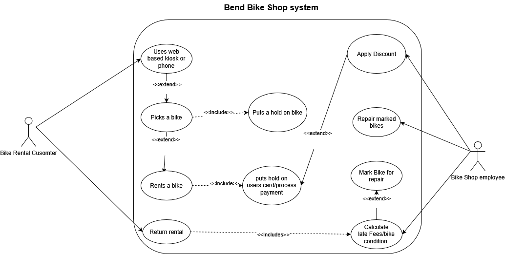

# **Overview**
Rodney Ridealot owns Bend Bike Shop and wants software that allows customers to easily rent a wide variety of bikes that fit their needs through a web based kiosk or their phones. The system will also help workers manage reservations, changes, cancellations, bike maintenance, and inventory reports, including each bike’s rental history and any problems found during inspections or maintenance.

# **User Scenarios**
**Scenario 1:**  Walter, 81, an outdoors person traveling and exploring Oregon, makes it to the lovely city of Bend, Oregon. He has read about how Bend has beautiful bike trails, and he wants to ride them, so he finds Rodney Ridealot Bike Shop and wants to rent a bike to actually be able to ride the trails. So, he makes it to the store and starts using the kiosk to rent a bike, BUT he forgot his reading glasses, and the text on the kiosk is really small, so it is difficult for him to read. He asks one of the employees for help guiding him through it and is able to rent a bike and enjoy the nice bike trails of Bend, Oregon. This scenario shows that there should be a text accessibility option for older people or people who have difficulty seeing small text. However, it is good that there are employees still present, so there is a way for customers to be able to rent bikes.

**Scenario 2:** Bonnie, 19, is an outdoor person who likes to hike, mountain climb, swim, and loves to ride bikes. Bonnie came to Bend, Oregon, looking for the outdoor adventures she heard about here, and she finds out that there is a really difficult bike trail that she wants to do. So, she hits up Rodney Ridealot Bike Shop to rent a mountain bike for this challenge, but Bonnie isn't a typical person. She has high standards when it comes to stuff. She will not use the web-based kiosk or her phone if the bike rental user interface isn't simple to understand and organized enough either. Her key risk points: ugly user interface, unorganized user interface, and slow web-based loading.

**Scenario 3:** Jake, 25, is a new employee at Rodney Ridealot Bike Shop. He enjoys biking but is still learning the ropes at work. A customer walks in wanting to rent two recreational bikes but is struggling to use the self-service kiosk. Jake steps in, opens the rental screen, and helps the customer search for available bikes by type and rental time. He expects the system to display clear availability, rental prices, and bike details so he can help the customer make a quick decision. His key risk points: confusing navigation, inaccurate availability, or a rental process that requires him to restart everything if the customer makes a mistake.

**Scenario 4:**  Chris, 35, is responsible for coordinating bike maintenance at the shop. During a routine inspection, he discovers that a performance bike has worn brake pads. He opens the bike's inventory record and selects the option to take it out of service. He enters the reason for maintenance and saves the changes. Chris expects the system to mark the bike as unavailable so employees cannot rent it out while it needs repairs. After the brake pads are replaced, he inspects the bike and updates its status once it is cleared for use. His key risk points: a bike remaining available after being removed from service, no record of why it was taken out of service, or no clear way to return it to the available inventory after inspection.

# **Non-Goals**    
- Selling bikes will be separate from the rental system.
- Advertising will be handled by a separate team, so we don't need to build that into the system.
- All bike pickups and returns will happen through an employee during business hours, so after-hours rentals are not needed.
- Automatic discounts based on bike availability are not needed for now.
- Rental extensions will be handled manually by having customers call an employee.
- Handling business cancellations due to inventory shortages will be put off for now.
- Missing or stolen bikes will need to be reviewed by a manager instead of automatically charging the customer.

# **Use Case Diagrams**
 
